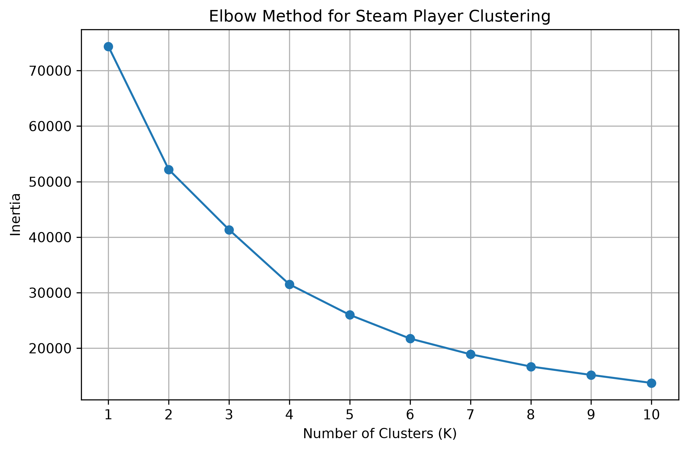
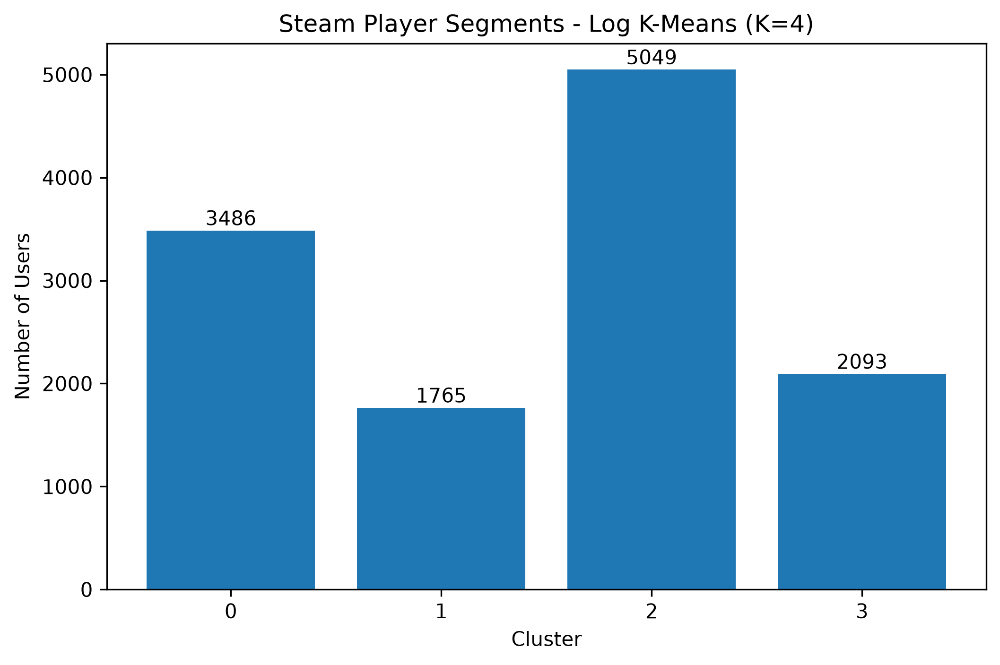
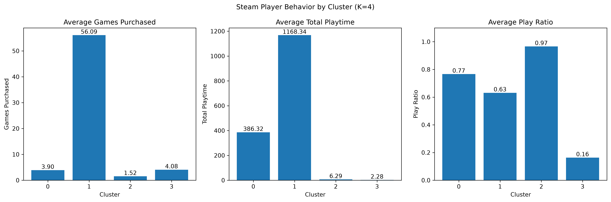
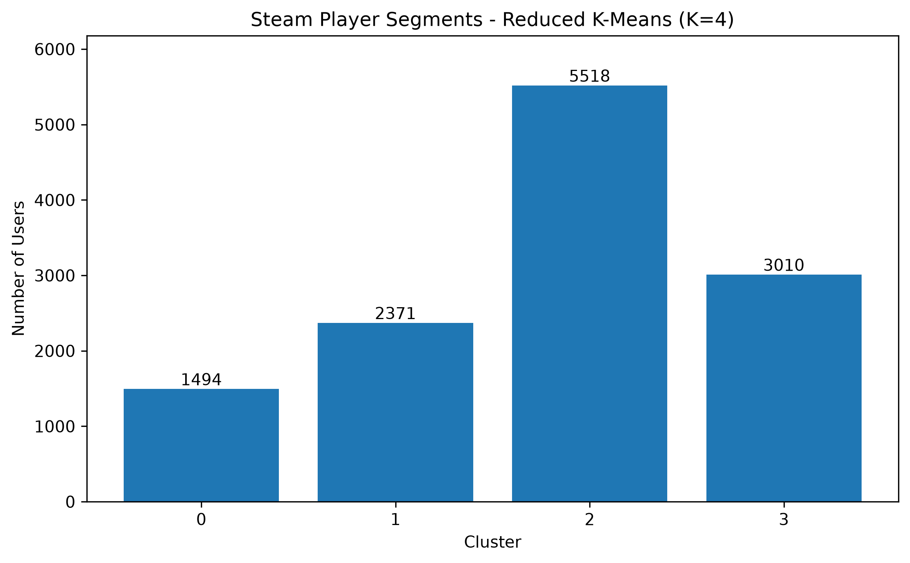

= Clustering

== 1. Initial K-Means Model

I started the clustering process using K-Means to group Steam users based on their gaming behavior.

First, I standardized the numerical features using StandardScaler, then created a K-Means model with 3 clusters.

StandardScaler standardizes the features so that their different numerical scales do not dominate the clustering.

KMeans divides the users into 3 groups based on similarities in their behavioral features.

I will evaluate the clustering using three metrics:

* Silhouette Score: Measures how well the clusters are separated. Higher is better.
* Davies-Bouldin Index: Measures cluster similarity and separation. Lower is better.
* Inertia: Measures the sum of squared distances between users and their cluster centers. Lower values indicate more compact clusters, but must be compared across different K values.

== 2. Initial Clustering Results

I ran my first K-Means model using 3 clusters, StandardScaler, random_state=13, and a sample of 6000 users for the Silhouette Score.

The model produced the following results:

* Silhouette Score: 0.7376
* Davies-Bouldin Index: 0.9721
* Inertia: 41341.29

Cluster sizes:

* Cluster 0: 481 users
* Cluster 1: 11,634 users
* Cluster 2: 278 users

=== Evaluation

The Silhouette Score of 0.7376 suggests that the clusters are relatively well separated.

However, the cluster sizes are very unbalanced. Around 94% of users belong to one cluster, while the other two clusters contain only a small number of users.

This may indicate that K-Means is separating users with extreme gaming behavior from the majority.

The Davies-Bouldin Index and Inertia will be used to compare this baseline with future models.

Before improving the model, I will examine the characteristics of each cluster to understand which types of players they represent.

== 3. Cluster Profiling

I examined the mean and median values of the six behavioral features for each cluster.

The results suggest three different player groups:

* Cluster 0 (481 users): Dedicated Players. These users spend a large amount of time playing a relatively small number of games.
* Cluster 1 (11,634 users): Low-Activity Players. Most users belong to this group. Their median total playtime is only 10.1 hours.
* Cluster 2 (278 users): Large-Library Players. These users own and play many different games, with an average of 186 purchased games and 94 played games.

=== Evaluation

Clusters 0 and 2 have similar average total playtime (approximately 2,500 hours), but very different gaming habits.

Cluster 0 concentrates more playtime on individual games, while Cluster 2 distributes its playtime across many different games.

This suggests that the model identifies meaningful differences in player behavior.

However, the cluster sizes are highly unbalanced, and almost 94% of users belong to Cluster 1.

I will therefore test different numbers of clusters to determine whether the users can be divided into more informative groups.

== 4. Elbow Method

I used the Elbow Method to investigate the optimal number of clusters.

I tested K values from 1 to 10 and plotted the Inertia for each model.

The graph shows that Inertia decreases rapidly until approximately K=4, after which the improvement becomes smaller.

This suggests that K=4 might be a good choice, but the elbow is not completely clear.

I will compare Silhouette Scores and Davies-Bouldin Index values for different numbers of clusters.

== 5. Comparing Different K Values

I tested K-Means models with K values from 2 to 10 and compared their Silhouette Scores and Davies-Bouldin Index values.

[cols="1,2,2",options="header"]
|===
|K |Silhouette Score |Davies-Bouldin Index
|2 |0.7363 |1.1336
|3 |0.7376 |0.9721
|4 |0.5553 |0.9132
|5 |0.5908 |0.9746
|6 |0.5895 |0.8681
|7 |0.6087 |0.9317
|8 |0.6158 |0.8781
|9 |0.5769 |0.8675
|10 |0.5842 |0.8967
|===

=== Results and Evaluation

K=3 achieved the highest Silhouette Score (0.7376), suggesting the best cluster separation among the tested models according to this metric.

K=9 achieved the lowest Davies-Bouldin Index (0.8675), but its Silhouette Score was considerably lower.

The Elbow Method suggested approximately K=4, although there was no clear elbow.

Based on these results, K=3 remains our preferred baseline. However, almost 94% of users belong to one cluster.

I will examine alternative clustering configurations to see whether I can identify more informative player segments.

== 6. Model Improvement alternative clustering configurations: Log Transformation

I created a separate Python script, `code/clustering_log.py`, to test whether logarithmic transformation improves the clustering results.

I applied `np.log1p()` to the game count and playtime features because the EDA showed highly skewed distributions and extreme values.

After the transformation, I used StandardScaler and trained K-Means with the same parameters as the baseline model (K=3, random_state=13, n_init=10).

This experiment aims to reduce the influence of extreme values and identify potentially more informative player segments.

I will compare the evaluation scores, cluster sizes, and behavioral profiles with the original baseline model.

== 7. Log Transformation Results

I ran the K-Means model with logarithmic transformation using K=3.

The results were:

* Silhouette Score: 0.3940
* Davies-Bouldin Index: 0.9737
* Inertia: 29025.27

Cluster sizes:

* Cluster 0: 1,885 users (15.2%)
* Cluster 1: 6,579 users (53.1%)
* Cluster 2: 3,929 users (31.7%)

=== Evaluation

The logarithmic transformation produced more balanced cluster sizes compared to the baseline model.

I identified three player groups:

* Cluster 0: Large-Library Active Players, who own and play many different games.
* Cluster 1: Low-Activity Players, who own few games and have very low recorded playtime.
* Cluster 2: Focused Players, who spend considerable time playing a small number of games.

The Silhouette Score decreased from 0.7376 to 0.3940, while the Davies-Bouldin Index remained almost unchanged.

Since the transformation changes the feature space, these scores are not directly comparable as measures of improvement.

Although the clusters are less clearly separated in the transformed space, their sizes and behavioral profiles appear more useful for player segmentation.

Next, like before i will test different K values on the transformed dataset.

== 8. Log Transformation: Comparing K Values

I tested different numbers of clusters (K=2 to K=10) using the logarithmically transformed dataset.

[cols="1,2,2,2",options="header"]
|===
|K |Silhouette Score |Davies-Bouldin |Largest Cluster
|2 |0.4307 |0.9948 |61.2%
|3 |0.3940 |0.9737 |53.1%
|4 |0.4400 |0.8640 |40.7%
|5 |0.4189 |0.9788 |30.2%
|6 |0.4354 |0.9036 |28.8%
|7 |0.4278 |0.9437 |27.9%
|8 |0.4297 |0.9461 |25.8%
|9 |0.4318 |0.9158 |25.8%
|10 |0.4374 |0.9310 |25.1%
|===

=== Evaluation

K=4 achieved both the highest Silhouette Score (0.4400) and the lowest Davies-Bouldin Index (0.8640).

Compared to K=3, the largest cluster decreased from 53.1% to 40.7%.

These results suggest that K=4 is a promising choice for the logarithmically transformed dataset.

Now I will examine the four cluster profiles to determine whether they represent meaningful player segments.

== 9. K=4 Cluster Profiling

After comparing different K values, I examined that the four clusters produced by the logarithmic K-Means model with K=4.

The model achieved a Silhouette Score of 0.4400 and a Davies-Bouldin Index of 0.8640.

I identified four different player segments:

* Cluster 0 - Focused Players (3,486 users): Own relatively few games but spend considerable time playing them.
* Cluster 1 - Large-Library Players (1,765 users): Own and play many different games, with high total playtime.
* Cluster 2 - Casual Players (5,049 users): Own few games and have low total playtime, but play most of their purchased games.
* Cluster 3 - Inactive Library Owners (2,093 users): Own several games but play very few of them.

=== Evaluation

The four clusters show meaningful differences in game ownership, playtime, and play ratio.

An interesting finding is the difference between Clusters 2 and 3. Both have low playtime, but Cluster 2 plays almost all purchased games, while Cluster 3 leaves most games unplayed.

Compared to the baseline model, the logarithmic K=4 model produces more balanced and potentially more useful player segments.

These segments could provide a foundation for personalized game recommendations and notifications.

The logarithmic K=4 model is currently my preferred candidate, although further validation is needed.

=== Cluster Size Visualization

I created a bar chart showing the number of users in each cluster.

The largest cluster contains 5,049 users (40.7%), while the smallest contains 1,765 users (14.2%).

Compared to the baseline model, users are distributed more evenly across the four clusters.

== 10. Cluster Stability Test

I tested the stability of the logarithmic K-Means model (K=4) using six different random states.

I used the Adjusted Rand Index (ARI) to compare the cluster assignments with the original K=4 model.

[cols="1,2",options="header"]
|===
|Random State |Adjusted Rand Index
|0 |1.0000
|7 |1.0000
|13 |1.0000
|24 |1.0000
|42 |1.0000
|99 |1.0000
|===

=== Evaluation

All tested random states produced an ARI of 1.0000, meaning that the cluster assignments were identical, apart from possible differences in cluster numbering.

This indicates that my K=4 model is stable across the tested initializations.

These results support using the logarithmic K-Means model with K=4 as my preferred clustering configuration.

== 11. Cluster Feature Comparison

I created a visualization comparing three behavioral features across the four clusters: games purchased, total playtime, and play ratio.

=== Evaluation

Cluster 0 contains focused players who spend considerable time playing relatively few games.

Cluster 1 has the highest average game ownership and total playtime.

Cluster 2 has low playtime but a high play ratio, meaning that users play most of their purchased games.

Cluster 3 has the lowest play ratio, indicating that many purchased games remain unplayed.

The figure shows that there is still a big difference between cluster 2 and 3.

I will try to make a new modell with reduced feature set (games_purchased, games_played, total_playtime, play_ratio) where i use only 4 features to determine the optimal number of clusters

== 12. Reduced Feature Model

I created a new script, `clustering_reduced.py`, to test K-Means with four features instead of six.

I removed `avg_playtime` and `max_playtime` because they were highly correlated with other playtime features.

I kept the logarithmic transformation, StandardScaler, and K=4.

=== Results

* Silhouette Score: 0.4749
* Davies-Bouldin Index: 0.8704
* Inertia: 12184.59

I identified four player groups:

* Cluster 0 - Large-Library Players: 1,494 users
* Cluster 1 - Inactive Library Owners: 2,371 users
* Cluster 2 - Casual Players: 5,518 users
* Cluster 3 - Focused Players: 3,010 users

=== Evaluation

The Silhouette Score increased from 0.4400 to 0.4749 compared to the six-feature log model.

The Davies-Bouldin Index increased slightly from 0.8640 to 0.8704.

Although these scores were calculated in different feature spaces, the reduced model identified similar behavioral groups using fewer features.

The results suggest that four features may be sufficient for meaningful player segmentation.

I will test the stability of this model before making the final selection.

== 13. Reduced Feature Model Stability

I tested the stability of the Reduced Feature K-Means model (K=4) using six different random states.

[cols="1,2",options="header"]
|===
|Random State |Adjusted Rand Index
|1 |0.9978
|7 |0.9978
|13 |1.0000
|24 |0.9876
|42 |0.9944
|99 |0.9874
|===

=== Evaluation

The Adjusted Rand Index ranged from 0.9874 to 1.0000, with an average of 0.9942.

These results indicate that the model produces very similar clusters across different initializations.

Although the six-feature model was slightly more stable, the reduced model also showed excellent stability.

I selected the Reduced Feature K-Means model (K=4) as my final model because it uses fewer features while maintaining four meaningful player segments and strong stability.

=== Final Model Cluster Sizes

I created a bar chart to visualize the cluster sizes of the Reduced Feature K-Means model (K=4).

The largest group is Casual Players (5,518 users), representing 44.5% of the dataset.

The smallest group is Large-Library Players (1,494 users), representing 12% of the users.

The model produces four meaningful player segments with a more balanced distribution than the original baseline.